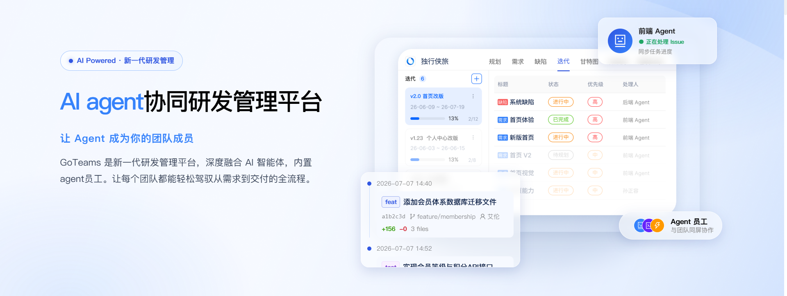
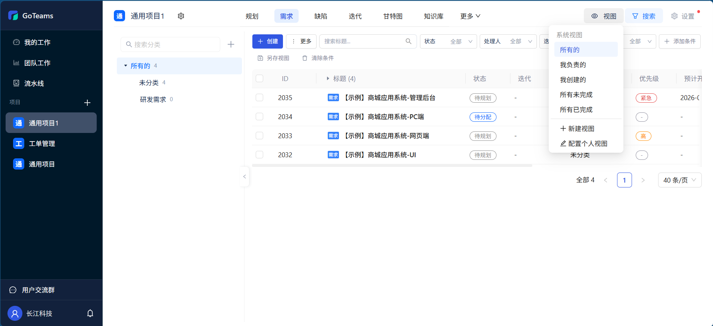
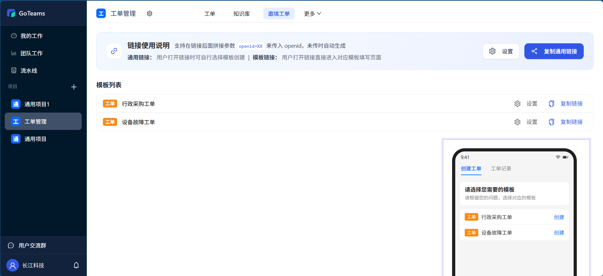
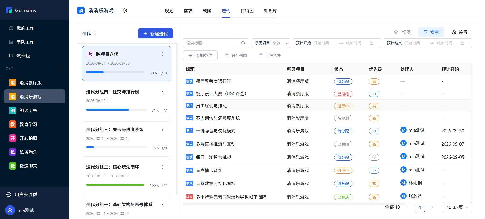
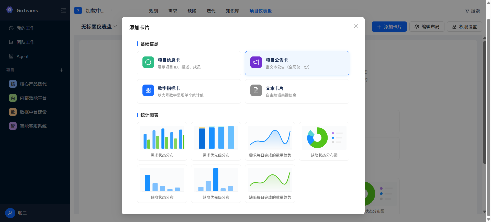
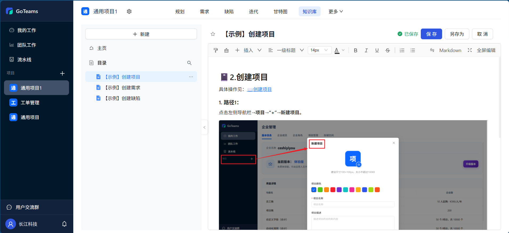
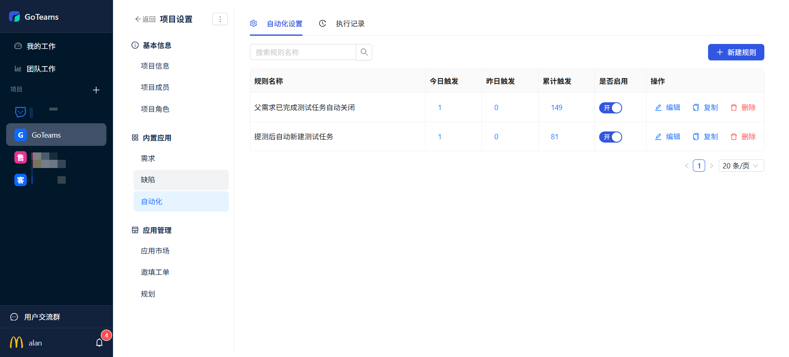
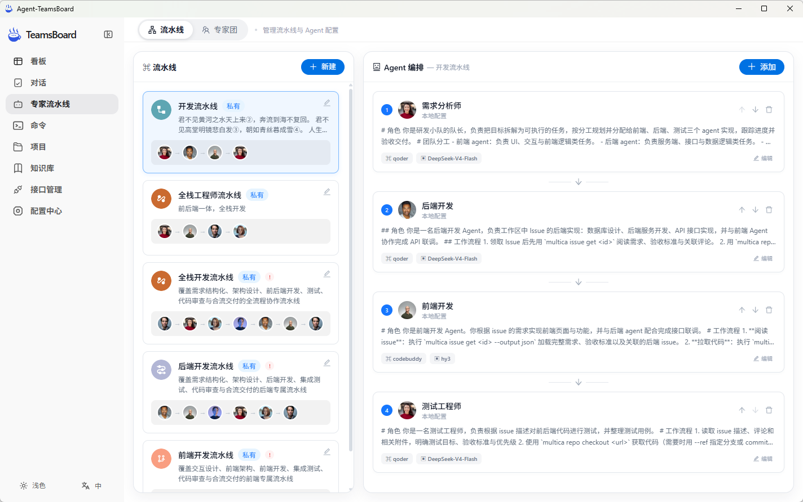

<p align="center"><a href="https://goteams.cn"></a></p>

<p align="center">
  <a href="./README_en.md">English</a> |
  <a href="./README.md">简体中文</a> |
  <a href="./UpdateLog.md">更新日志</a>
</p>

## 🎯 产品定位

GoTeams 是新一代 AI研发协作平台，让 Agent 成为你的团队成员。深度融合 AI 智能体，内置 Agent 员工。让每个团队都能轻松驾驭从需求到交付的全流程。

## 🌍 免费体验网址：[goteams.cn](https://goteams.cn)

## ✨ 核心特性

### 🤖 需求/缺陷 - 灵活定制，精细管理

支持自定义工作项类型、字段、流程、视图，完美适配不同团队的研发管理规范。



### 🤖 工单管理 - 多端协同，全流程闭环管理

内置工单项目模板快速启动。支持邀请用户主动创建工单、用户可见工单状态可在线留言催单、预制各类视图快速查看对应工单



### 🤖 项目管理 - 适配各类敏捷瀑布管理场景

标准化敏捷和瀑布管理模型，从产品规划到执行跟踪的全流程管理，每个环节都有丰富的工具支撑，帮助你把控风险，按质量交付项目成果。



### 🤖 进度管理 - 研发效能数据化、目标透明化

专业的统计报表，帮助你跟踪与复盘研发流程，不断提升研发质量。实现从项目到任务的多层级规划，实时追踪执行进度



### 🤖 知识管理 - 协同共享，让知识流转更高效

周报、会议记录、需求文档、研发方案、测试用例等各类项目知识高效沉淀，帮助团队向知识型组织迈进



### 🤖 自动化流程 - 全流程智能自动化，高效运转

通过自动化规则引擎，让重复性的协作流程自动执行，自动处理。内置钉钉飞书企微 webhook 推送，重要信息实时同步。



### 🤖 Agent 协作 - 从创作到实现，AI 无处不在

内置 agent 技能，一键安装，快速启动。实现 agent 与系统的无缝衔接，快速提升研发生产力。




## 🏢 开源版安装部署

需要 Docker（含 Compose V2）以及构建用的 Go、Node.js；在本地打包后直接用 Docker Compose 运行，不需要安装脚本。

### 1. 环境要求

- Docker 20.10+ 与 Docker Compose V2（`docker compose version` 可用）。
- Go 版本满足 `go.mod`（当前最低 1.25.1）。
- Node.js 18+ 与 npm（前端使用 Vite 5）。
- 首次构建需联网下载 Go/npm 依赖。

### 2. 准备配置

首次运行先把 `docker/.env.example` 复制为 `docker/.env`，再编辑配置：

```bash
cp docker/.env.example docker/.env
```

- `docker/.env` 的 `POSTGRES_PASSWORD`、`REDIS_PASSWORD` 必须与 `configs/goteams/config_pro.ini` 中 `[postgres].password`、`[redis].password` 一致；仓库默认值可直接启动，生产部署请改成自定义密码并同步修改两处。
- `configs/goteams/config_pro.ini` 的 `[webservice].site_url` 改为实际访问地址，用于生成工作项链接。
- 默认管理员为 `admin / admin123456`，首次登录会强制修改密码。
- 对象存储、邮件、扫码登录、SSO、会话加密默认关闭，按需填写启用。

### 3. 打包

在仓库根目录执行：

```bash
make goteams
```

该命令先构建前端（生成 `web/dist.tar.gz`），再编译 Linux amd64 后端 `build/goteams`。没有 GNU Make 时手动执行等价命令：

```bash
cd web && npm ci && npm run build && cd ..
CGO_ENABLED=0 GOOS=linux GOARCH=amd64 go build -trimpath -o build/goteams ./cmd/goteams
```

### 4. 运行

```bash
cd docker
docker compose --env-file .env up -d
```

浏览器访问 `http://127.0.0.1:8080`（端口由 `docker/.env` 的 `WEB_PORT` 控制）。查看日志使用 `docker compose logs -f goteams`，停止使用 `docker compose down`。

### 5. 升级

拉取新代码后重新执行 `make goteams`，再执行 `docker compose --env-file .env up -d`。数据卷会保留，不需要重新初始化数据库。

## 💻 技术栈

---

- **后端**：Go + Gin

- **前端**：Vue 3 + Ant Design Vue + Vite

- **数据库**：PostgreSQL 16 + Redis

## 🏡 社区交流 & 联系我们

---

欢迎联系我们获取帮助，或者提供建议帮助我们改善 GoTeams。您可以通过以下方式联系我们：

- **邮箱**：发送邮件到 [jarvis@2bai.com.cn](mailto:jarvis@2bai.com.cn) 联系我们。

## 📖 更新日志

---

- 2026.9.08
  - 自动化规则支持跨项目复制
- 2026.9.07
  - 主导航的样式优化-增加【更多】菜单
- 2026.9.04
  - 新增项目时支持选择项目模板
  - 工作项模板支持联动显示

## 协议

---

本项目采用 **GoTeams 社区源代码可用许可 1.0**（源码可用，但非 OSI 认可的开源许可证）。在免费阈值内（活跃用户 ≤ 50 人且存储空间 ≤ 1000 GB）可免费使用、修改和分发，超出阈值需事先获得商业授权。完整的许可证文本请查看 [LICENSE](./LICENSE) 文件，商业授权联系：fox@chatwiki.com。
