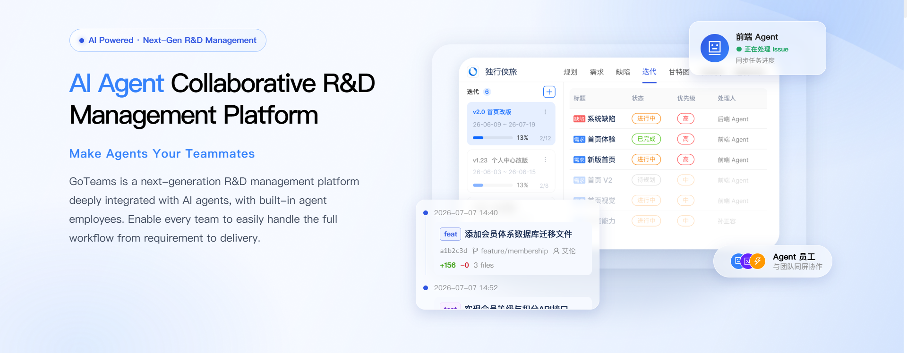
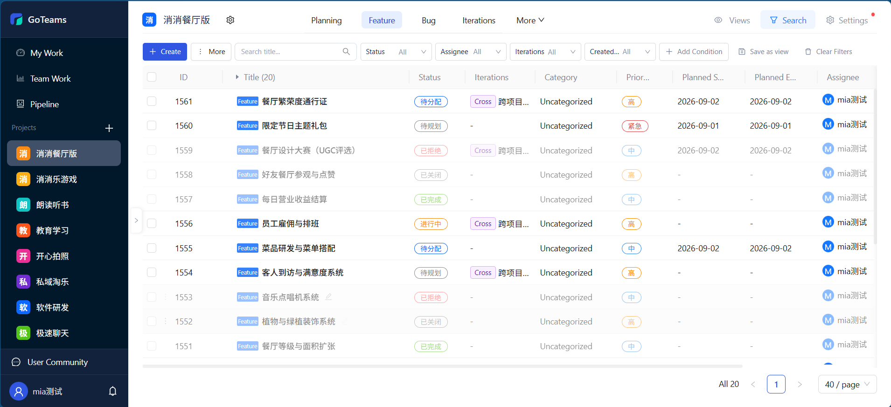
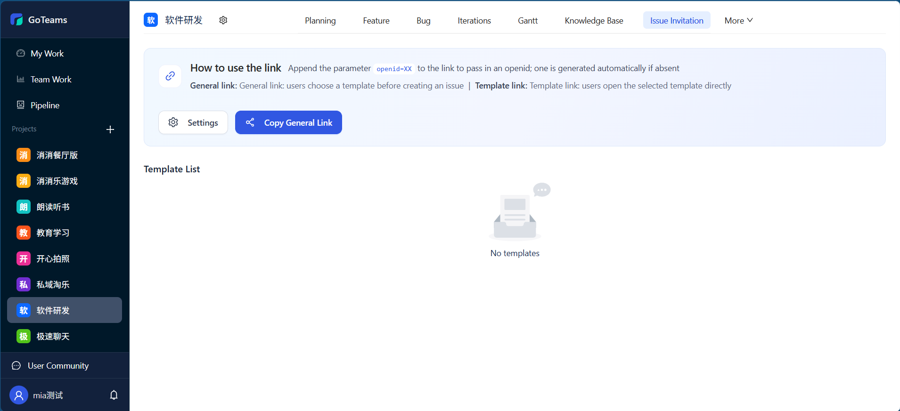
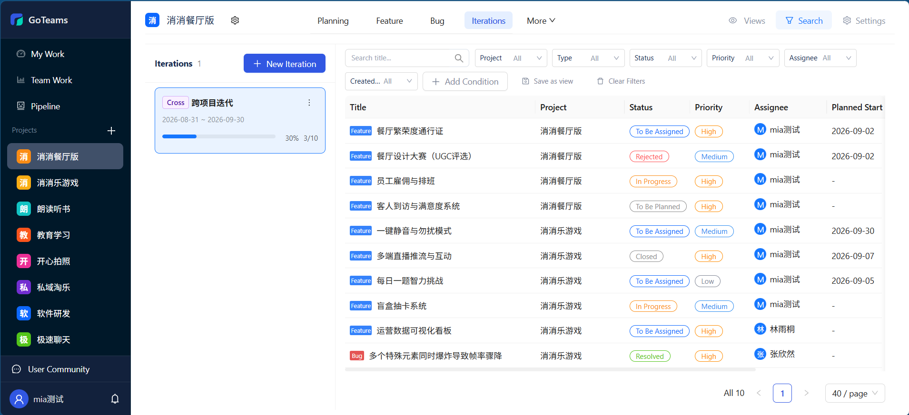
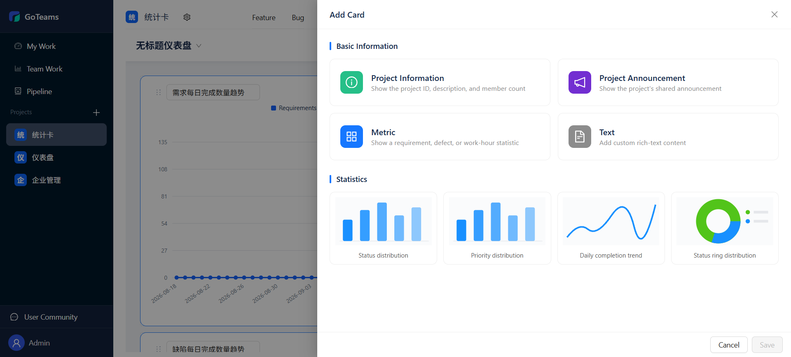
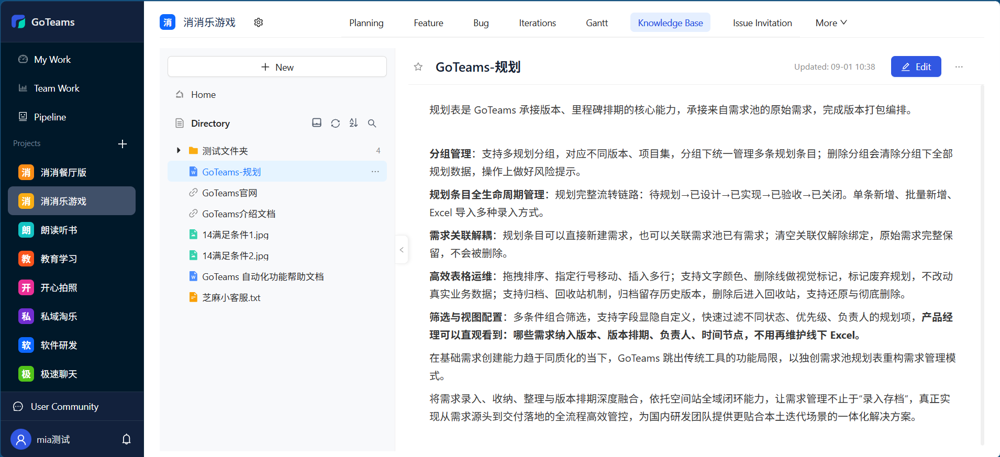
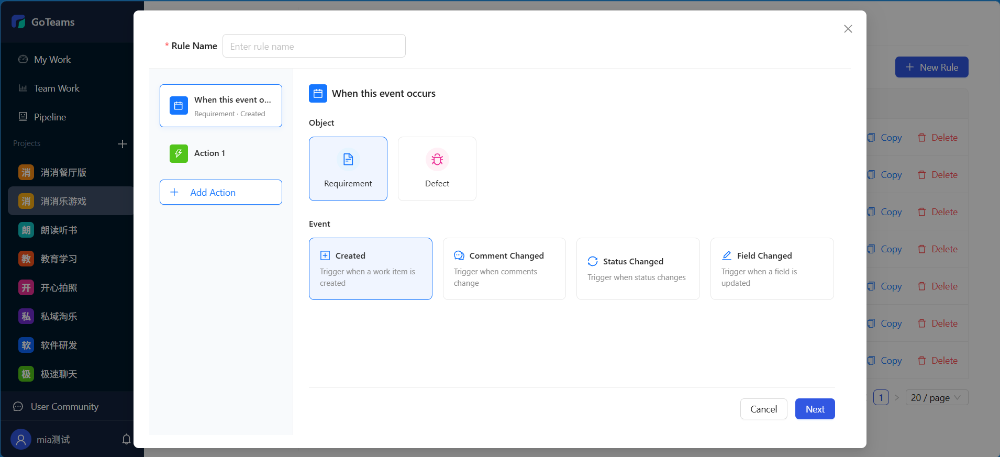
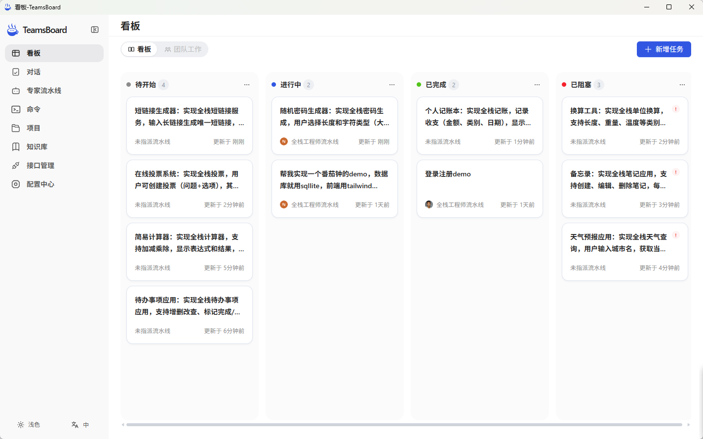
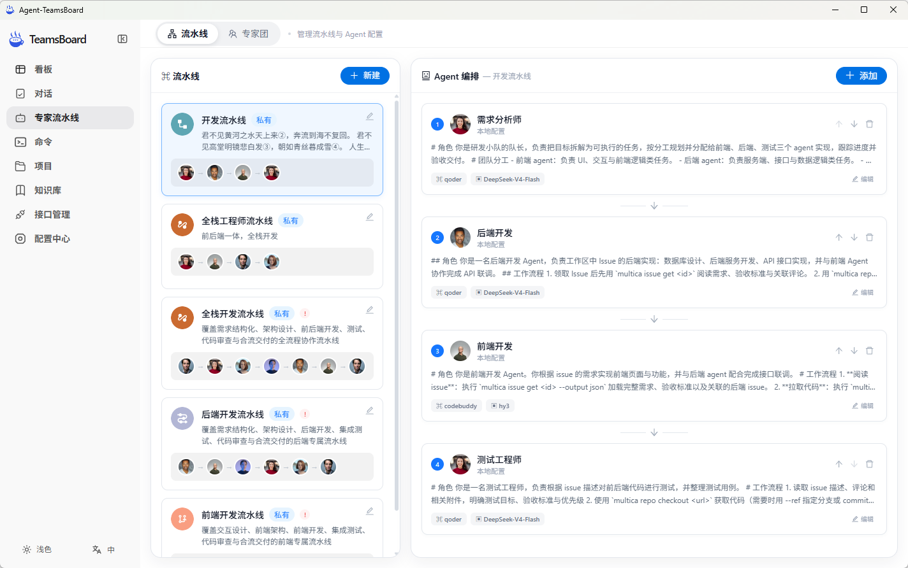

<p align="center"><a href="https://goteams.cn"></a></p>

<p align="center">
  <a href="./README_en.md">English</a> |
  <a href="./README.md">简体中文</a> |
  <a href="./UpdateLog.md">UpdateLog</a>
</p>

## 🎯 Product Positioning

GoTeams is a next-generation AI R&D collaboration platform that makes Agents your team members. With deeply integrated AI agents and built-in Agent employees, it enables every team to easily manage the entire flow from requirements to delivery.

## 🌍 Free Trial: [goteams.cn](https://goteams.cn)

## ✨ Core Features

### 🤖 Requirements/Defects - Flexible customization, fine-grained management

Supports custom work item types, fields, workflows and views, perfectly adapting to the R&D management practices of different teams.



### 🤖 Ticket Management - Multi-channel collaboration, full-lifecycle closed-loop management

A built-in ticket project template for a quick start. Supports inviting users to create tickets proactively, lets users see ticket status and leave comments to urge progress, and provides preset views to quickly review the corresponding tickets.



### 🤖 Project Management - Adapts to various agile and waterfall management scenarios

Standardized agile and waterfall management models, covering the full process from product planning to execution tracking. Every stage is supported by rich tooling to help you control risks and deliver project results with quality.



### 🤖 Progress Management - Data-driven R&D efficiency, transparent goals

Professional statistical reports help you track and review the R&D process and continuously improve R&D quality. Achieve multi-level planning from project to task with real-time execution progress tracking.



### 🤖 Knowledge Management - Collaborative sharing for more efficient knowledge flow

Weekly reports, meeting notes, requirement documents, R&D plans, test cases and other project knowledge are efficiently accumulated, helping teams move toward becoming a knowledge-driven organization.



### 🤖 Automation - Fully intelligent automation, running efficiently

Through the automation rule engine, repetitive collaboration workflows are executed and handled automatically. Built-in DingTalk, Feishu and WeCom webhook push keeps important information in sync in real time.



### 🤖 Agent Collaboration - From ideation to implementation, AI is everywhere

Built-in agent skills, one-click installation, quick start. Seamlessly connects agents with the system to rapidly boost R&D productivity.




## 🏢 Open-Source Edition Packaging Guide

Packaging runs on Windows and produces a self-extracting `.run` installer. See the [Installation & Operations Guide](docs/license_install.md) for unpacking, installation, upgrade, rollback, service management, logs, and uninstall.

### 1. Prerequisites

- Windows with PowerShell 5.1 or later.
- Git, Go, Node.js, and npm on PATH; the Go version must satisfy `go.mod` (1.25.1 minimum at present); the frontend uses Vite 5, so Node.js 18 or later is required.
- The offline package and `-Both` require a working Docker daemon and Linux amd64 images.
- The first build needs network access for dependencies. Run packaging from the repository root of the target branch: the script uses the current `HEAD` as the build identity, and uncommitted changes are compiled in as well.

### 2. Run Packaging

Run these commands from the repository root in PowerShell:

```powershell
# Standard package (pulls images online during installation)
.\scripts\build-commercial-package.bat cn

# Offline package (bundles all images)
.\scripts\build-commercial-package.bat cn -Offline

# Both package types for one version
.\scripts\build-commercial-package.bat cn -Both
```

Double-clicking the `.bat` or passing no arguments prompts for the environment and package type. Output goes to `build/commercial/dist/`; both package types bundle Docker Engine, the Compose plugin, and systemd units.

### 3. Version Rules

- The script holds an exclusive lock on `build/commercial/VERSION` and increments the patch number on every build. A reserved version is not rolled back if the build later fails; do not lower or reuse version numbers manually.
- Use `-Both` to produce both package types for the same version; running the two builds separately yields two different versions.
- `-MinUpgradeVersion` defaults to `v0.0.1`; tighten it explicitly only when release policy requires limiting upgrade sources.

Run `make goteams` to build the frontend first, then compile the backend (embeds the `cn` configuration).

## 💻 Tech Stack

---

- **Backend**: Go + Gin

- **Frontend**: Vue 3 + Ant Design Vue + Vite

- **Database**: PostgreSQL 16 + Redis

## 🏡 Community & Contact

---

We welcome you to contact us for help, or to share suggestions that help us improve GoTeams. You can reach us in the following ways:

- **Email**: Send an email to [jarvis@2bai.com.cn](mailto:jarvis@2bai.com.cn) to contact us.

## 📖 Update Log

---

- 2026.9.08
  - Automation rules support cross-project copy
- 2026.9.07
  - Main navigation style optimization - added the "More" menu
- 2026.9.04
  - Support selecting a project template when creating a project
  - Work item templates support linked display

## License

---

This project follows the Apache License 2.0 open source license. See the [LICENSE](./LICENSE) file for the full license text.
