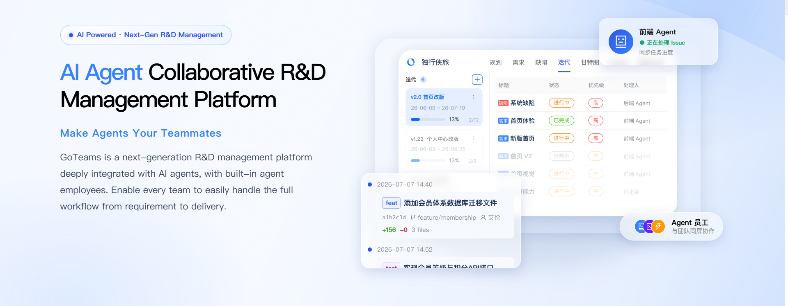
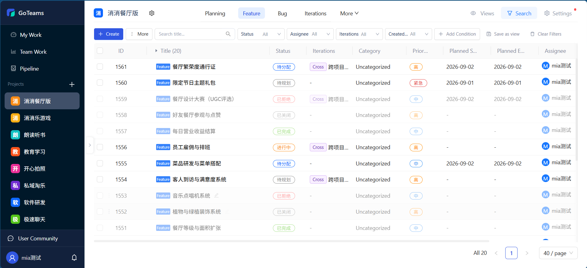
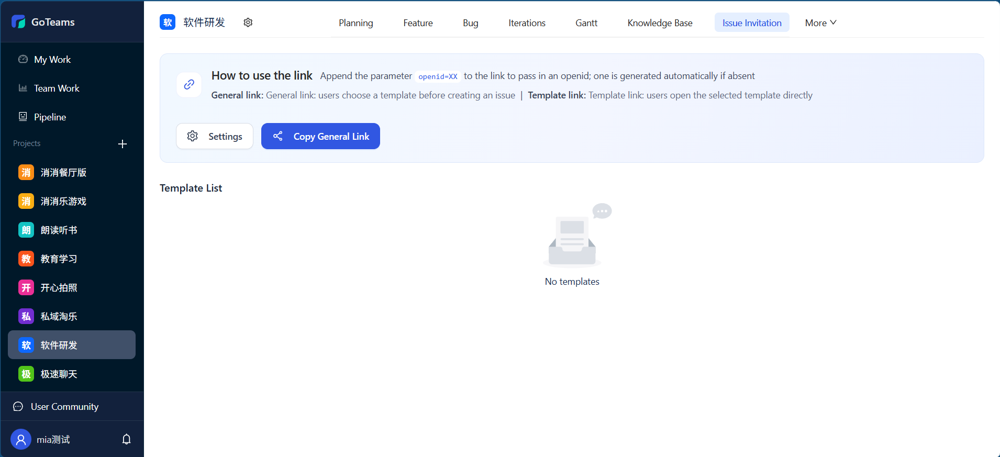
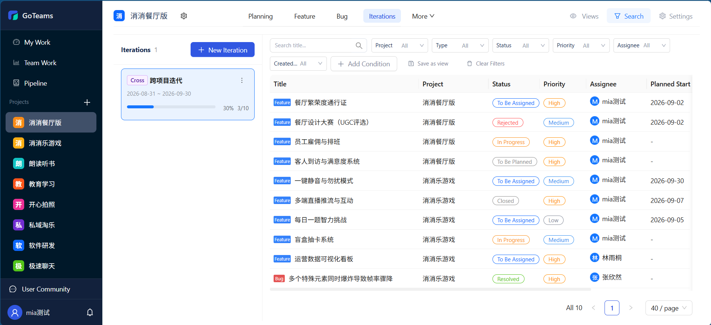
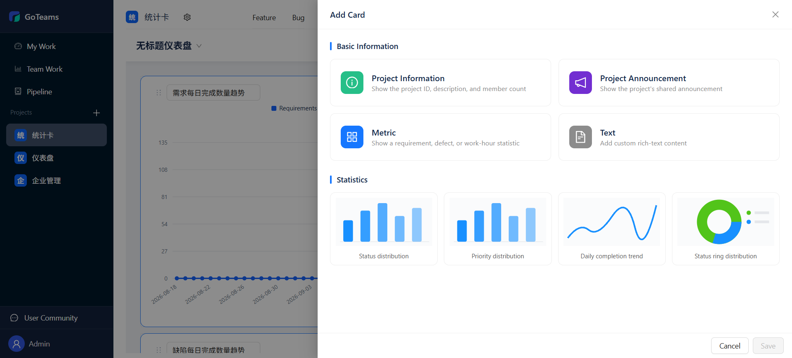
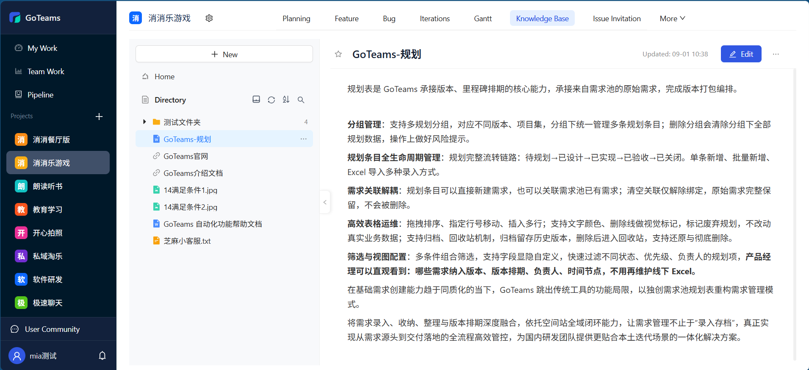
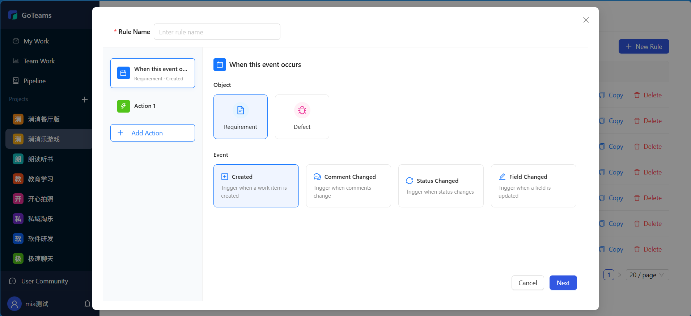
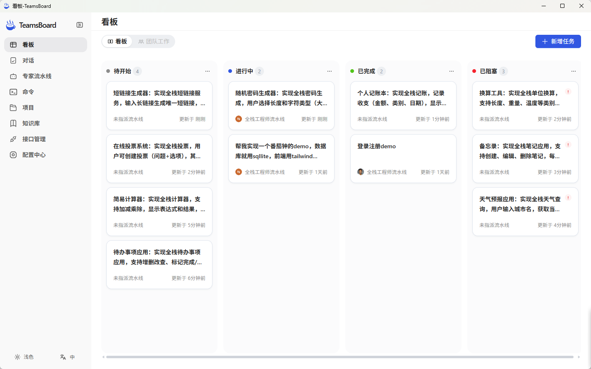
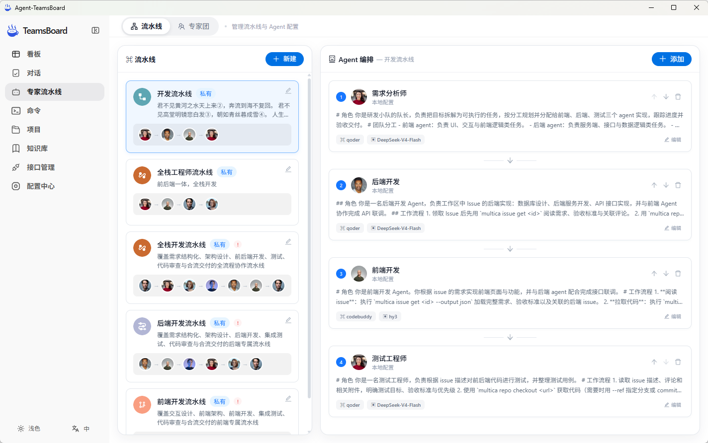

<p align="center"><a href="https://goteams.cn"></a></p>

<p align="center">
  <a href="./README_en.md">English</a> |
  <a href="./README.md">简体中文</a> |
  <a href="./UpdateLog.md">UpdateLog</a>
</p>

## 🎯 Product Positioning

GoTeams is a next-generation AI R&D collaboration platform that makes Agents your team members. With deeply integrated AI agents and built-in Agent employees, it enables every team to easily manage the entire flow from requirements to delivery.

## 🌍 Free Trial: [goteams.cn](https://goteams.cn)

## ✨ Core Features

### 🤖 Requirements/Defects - Flexible customization, fine-grained management

Supports custom work item types, fields, workflows and views, perfectly adapting to the R&D management practices of different teams.



### 🤖 Ticket Management - Multi-channel collaboration, full-lifecycle closed-loop management

A built-in ticket project template for a quick start. Supports inviting users to create tickets proactively, lets users see ticket status and leave comments to urge progress, and provides preset views to quickly review the corresponding tickets.



### 🤖 Project Management - Adapts to various agile and waterfall management scenarios

Standardized agile and waterfall management models, covering the full process from product planning to execution tracking. Every stage is supported by rich tooling to help you control risks and deliver project results with quality.



### 🤖 Progress Management - Data-driven R&D efficiency, transparent goals

Professional statistical reports help you track and review the R&D process and continuously improve R&D quality. Achieve multi-level planning from project to task with real-time execution progress tracking.



### 🤖 Knowledge Management - Collaborative sharing for more efficient knowledge flow

Weekly reports, meeting notes, requirement documents, R&D plans, test cases and other project knowledge are efficiently accumulated, helping teams move toward becoming a knowledge-driven organization.



### 🤖 Automation - Fully intelligent automation, running efficiently

Through the automation rule engine, repetitive collaboration workflows are executed and handled automatically. Built-in DingTalk, Feishu and WeCom webhook push keeps important information in sync in real time.



### 🤖 Agent Collaboration - From ideation to implementation, AI is everywhere

Built-in agent skills, one-click installation, quick start. Seamlessly connects agents with the system to rapidly boost R&D productivity.




## 🏢 Open-Source Edition Installation

Docker (with Compose V2), Go, and Node.js are required. Build locally, then run the stack with Docker Compose; no installer script is needed.

### 1. Prerequisites

- Docker 20.10+ with Compose V2 (`docker compose version` works).
- Go version satisfying `go.mod` (1.25.1 minimum at present).
- Node.js 18+ and npm (the frontend uses Vite 5).
- Network access for Go/npm dependencies on the first build.

### 2. Configure

For the first run, copy `docker/.env.example` to `docker/.env`, then edit the configuration:

```bash
cp docker/.env.example docker/.env
```

- `POSTGRES_PASSWORD` and `REDIS_PASSWORD` in `docker/.env` must match `[postgres].password` and `[redis].password` in `configs/goteams/config_pro.ini`; the repository defaults start out of the box, but production deployments should use custom passwords and update both places.
- Set `[webservice].site_url` in `configs/goteams/config_pro.ini` to the public URL used in work-item links.
- The default administrator is `admin / admin123456`; a password change is forced on first login.
- Object storage, email, OAuth login, SSO, and session encryption are disabled by default; enable them as needed.

### 3. Build

Run from the repository root:

```bash
make goteams
```

This builds the frontend (`web/dist.tar.gz`) and the Linux amd64 backend (`build/goteams`). Without GNU Make, run the equivalent commands:

```bash
cd web && npm ci && npm run build && cd ..
CGO_ENABLED=0 GOOS=linux GOARCH=amd64 go build -trimpath -o build/goteams ./cmd/goteams
```

### 4. Run

```bash
cd docker
docker compose --env-file .env up -d
```

Open `http://127.0.0.1:8080` (the port is controlled by `WEB_PORT` in `docker/.env`). View logs with `docker compose logs -f goteams`; stop with `docker compose down`.

### 5. Upgrade

Pull the new code, run `make goteams` again, then run `docker compose --env-file .env up -d`. Data volumes are preserved and the database does not need to be re-initialized.

## 💻 Tech Stack

---

- **Backend**: Go + Gin

- **Frontend**: Vue 3 + Ant Design Vue + Vite

- **Database**: PostgreSQL 16 + Redis

## 🏡 Community & Contact

---

We welcome you to contact us for help, or to share suggestions that help us improve GoTeams. You can reach us in the following ways:

- **Email**: Send an email to [jarvis@2bai.com.cn](mailto:jarvis@2bai.com.cn) to contact us.

## 📖 Update Log

---

- 2026.9.08
  - Automation rules support cross-project copy
- 2026.9.07
  - Main navigation style optimization - added the "More" menu
- 2026.9.04
  - Support selecting a project template when creating a project
  - Work item templates support linked display

## License

---

This project is released under the **GoTeams Community Source-Available License 1.0** — source-available, but not an OSI-approved open source license. Use, modification, and distribution are free within the free thresholds (no more than 50 active users and no more than 1000 GB of storage), and usage beyond them requires a prior commercial license. See the [LICENSE](./LICENSE) file for the full text. Commercial licensing: fox@chatwiki.com.
