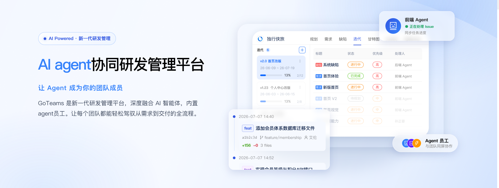
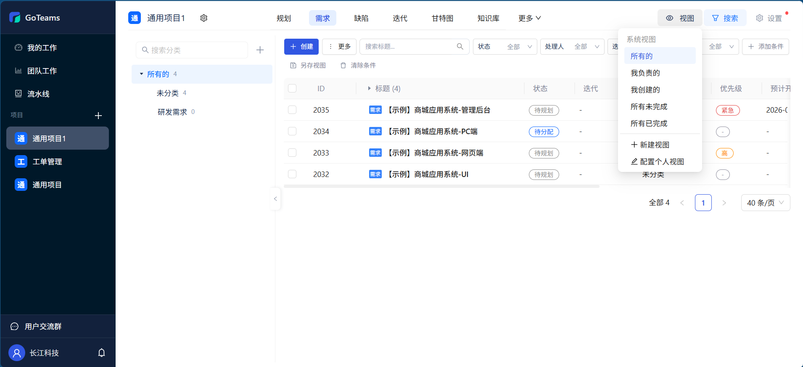
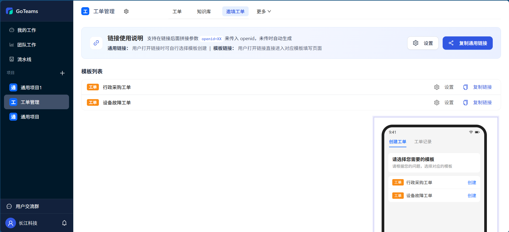
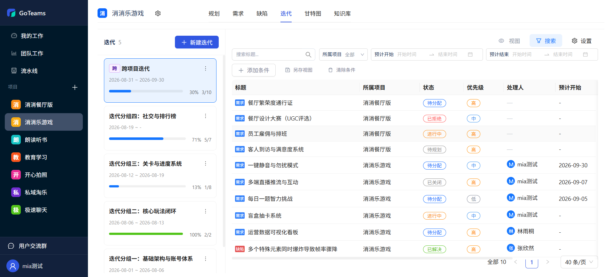
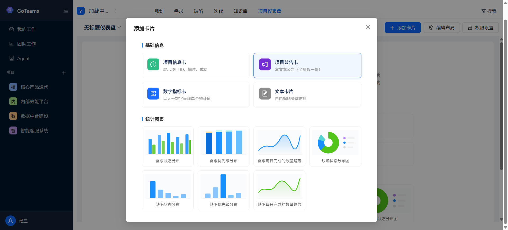
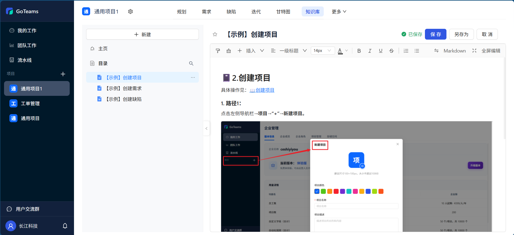
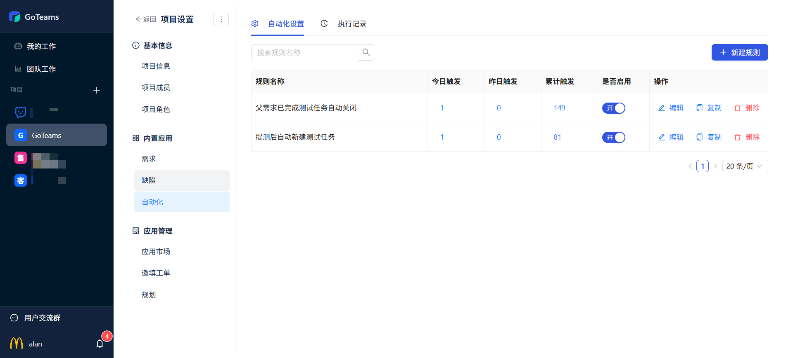
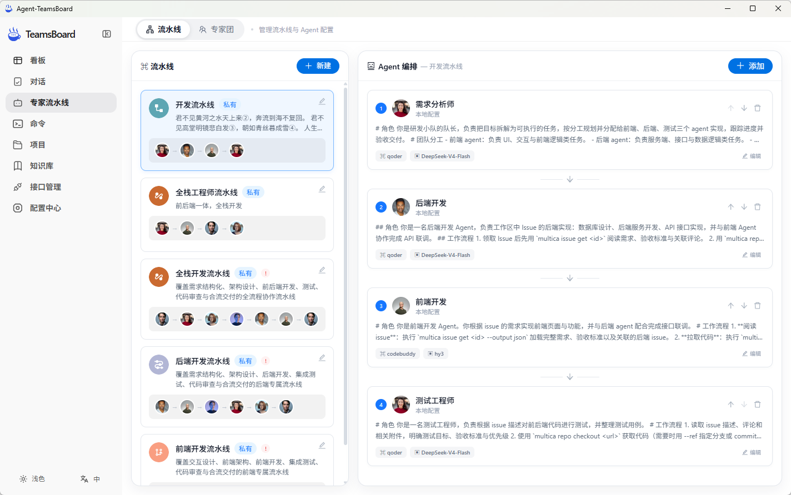

<p align="center"><a href="https://goteams.cn"></a></p>

<p align="center">
  <a href="./README.md">English</a> |
  <a href="./README_zh.md">简体中文</a> |
  <a href="./UpdateLog.md">更新日志</a>
</p>

## 🎯 产品定位

GoTeams 是新一代 AI研发协作平台，让 Agent 成为你的团队成员。深度融合 AI 智能体，内置 Agent 员工。让每个团队都能轻松驾驭从需求到交付的全流程。

## 🌍 免费体验网址：[goteams.cn](https://goteams.cn)

## ✨ 核心特性

### 🤖 需求/缺陷 - 灵活定制，精细管理

支持自定义工作项类型、字段、流程、视图，完美适配不同团队的研发管理规范。



### 🤖 工单管理 - 多端协同，全流程闭环管理

内置工单项目模板快速启动。支持邀请用户主动创建工单、用户可见工单状态可在线留言催单、预制各类视图快速查看对应工单



### 🤖 项目管理 - 适配各类敏捷瀑布管理场景

标准化敏捷和瀑布管理模型，从产品规划到执行跟踪的全流程管理，每个环节都有丰富的工具支撑，帮助你把控风险，按质量交付项目成果。



### 🤖 进度管理 - 研发效能数据化、目标透明化

专业的统计报表，帮助你跟踪与复盘研发流程，不断提升研发质量。实现从项目到任务的多层级规划，实时追踪执行进度



### 🤖 知识管理 - 协同共享，让知识流转更高效

周报、会议记录、需求文档、研发方案、测试用例等各类项目知识高效沉淀，帮助团队向知识型组织迈进



### 🤖 自动化流程 - 全流程智能自动化，高效运转

通过自动化规则引擎，让重复性的协作流程自动执行，自动处理。内置钉钉飞书企微 webhook 推送，重要信息实时同步。



### 🤖 Agent 协作 - 从创作到实现，AI 无处不在

内置 agent 技能，一键安装，快速启动。实现 agent 与系统的无缝衔接，快速提升研发生产力。




## 🏢 开源版打包指南

打包在 Windows 上完成，产物为自解压 `.run` 安装包；解压、安装、升级、回滚、服务管理与卸载见[开源版安装与运维指南](docs/license_install.md)。

### 1. 准备环境

- Windows，PowerShell 5.1 或更高版本。
- Git、Go、Node.js、npm 已加入 PATH；Go 版本满足 `go.mod`（当前最低 1.25.1），前端使用 Vite 5，Node.js 至少 18。
- 离线包和 `-Both` 需要可用的 Docker daemon，并准备 Linux amd64 镜像。
- 首次构建需联网获取依赖；在目标分支仓库根目录执行，脚本读取当前 `HEAD` 作为构建身份，未提交改动也会被编译进去。

### 2. 执行打包

以下命令在仓库根目录的 PowerShell 中执行：

```powershell
# 标准包（安装时联网拉取镜像）
.\scripts\build-commercial-package.bat cn

# 离线包（内含全部镜像）
.\scripts\build-commercial-package.bat cn -Offline

# 同一版本同时生成标准包与离线包
.\scripts\build-commercial-package.bat cn -Both
```

双击 `.bat` 或不传参数时交互选择环境与包类型。输出目录为 `build/commercial/dist/`，两类包都内置 Docker Engine、Compose 插件与 systemd 单元。

### 3. 版本规则

- 打包脚本独占锁定 `build/commercial/VERSION`，每次构建 patch 加一；成功占号后失败也不回退，不手动降低或复用版本。
- 同一版本的两类包使用 `-Both` 一次生成；分开运行会得到两个版本号。
- `-MinUpgradeVersion` 默认 `v0.0.1`，只有发布策略要求限制升级来源时才显式收紧。

执行 `make goteams` 会先构建前端，再编译后端（嵌入 `cn` 配置）。

## 💻 技术栈

---

- **后端**：Go + Gin

- **前端**：Vue 3 + Ant Design Vue + Vite

- **数据库**：PostgreSQL 16 + Redis

## 🏡 社区交流 & 联系我们

---

欢迎联系我们获取帮助，或者提供建议帮助我们改善 GoTeams。您可以通过以下方式联系我们：

- **邮箱**：发送邮件到 [jarvis@2bai.com.cn](mailto:jarvis@2bai.com.cn) 联系我们。

## 📖 更新日志

---

- 2026.9.08
  - 自动化规则支持跨项目复制
- 2026.9.07
  - 主导航的样式优化-增加【更多】菜单
- 2026.9.04
  - 新增项目时支持选择项目模板
  - 工作项模板支持联动显示

## 协议

---

本项目遵循 Apache License 2.0 开源协议，完整的许可证文本请查看 [LICENSE](./LICENSE) 文件。
